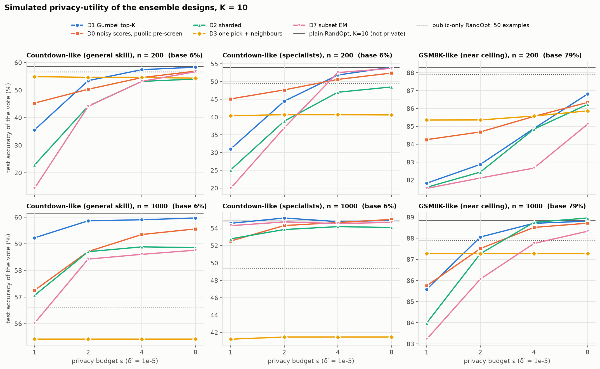
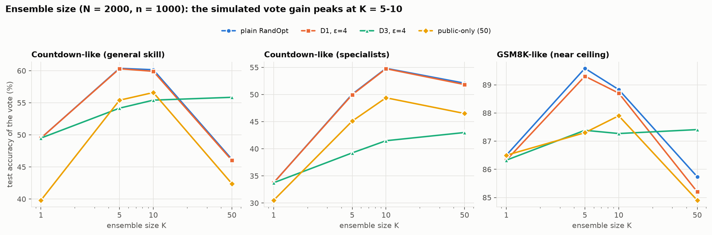
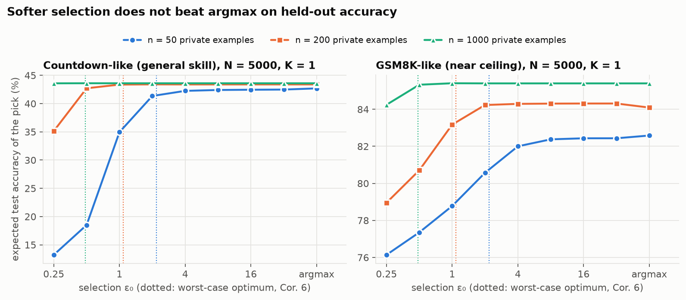

# DP-RandOpt: what the research plan survives, and what to change before spending GPU time

Executed October 5, 2026 against "Neural Thickets Follow-up: Adjacent Work and Research Plan" (October 4, 2026).

## Bottom line

The direction holds. The literature check found no work that privatizes selection among data-independent weight perturbations, and the core mechanism (Gumbel top-K plus zCDP accounting) is now implemented, unit-tested and cross-checked against AutoDP. Several parts of the plan need to change before the GPU budget is committed.

**Findings, in order of consequence**

1. **The public proxy can make the private data pointless.** In every simulator, plain RandOpt run on 200 public examples from the same distribution comes within 1.6 points of non-private RandOpt on the private pool. With 50 public examples it comes within 1–6 points. The plan tunes on such a split and allows a public pre-screen, but never reports public-only RandOpt. Without that baseline, gates G2 and G3 can pass while the private data adds nothing.
2. **K = 50 may be the wrong target.** In all three simulators the vote gain peaks at K = 5–10 and falls by K = 50 (N = 2,000). At K = 5–10, plain Gumbel top-K (design D1) keeps 95–100% of non-private RandOpt's gain at ε ≥ 2 with n ≥ 1,000. If the real score tables look like this, the "K bottleneck" behind the plan's ensemble designs mostly disappears. Phase 0 must measure the full K-curve before K is fixed.
3. **The worst-case bound table is very pessimistic.** For K = 10, ε = 1, n = 1,000 it promises at most 11.7 points of slack. Simulated D1 loses 0.3–3.3 points against non-private RandOpt at the same K. The bound's population version also suggests an optimal temperature (ε₀ ≈ 1) that costs up to 8 points on held-out data.
4. **Three corrections to the plan's privacy arithmetic:**
   - Countdown's reward runs from 0 to 1.1, so the sensitivity is 1.1, not 1.
   - The K-pick bound ignores that each pick can remove a good candidate. At the plan's own N = 1,000 with density 5% there are only 50 good candidates, so K = 50 needs N ≥ 2,000.
   - The tighter zCDP conversion (Canonne, Kamath & Steinke) gives back 8–20% of the per-pick budget.
5. **RandOpt's code differs from the plan's description in three ways that matter:**
   - σ is already drawn per candidate.
   - The default outputs release the selected models' training rewards.
   - Perturbations are layer-tied (the same noise matrix for every same-shaped tensor), and the in-place perturb/restore loop drifts by 0.2–0.56 σ in bf16.
6. **RQ2 needs a sharper statement.** Density enters every bound only through ln(1/density). A 10× density increase saves under half a point at ε = 1, n = 1,000. Any scale trend will come mostly from bigger gains in bigger models, not from cheaper selection. The trend is visible only in cells where privacy binds.
7. **The RQ4 audit plan does not work as written.** One-run canary audits cannot certify more than ε ≈ 2.8 with 50 informative canaries, even against plain RandOpt, which is not DP at all. Selection is cheap to rerun on the stored table, so use many-run audits and exact privacy curves instead.
8. **DP-ES is public (EMNLP 2026), and its private selection carries almost no signal.** At its published noise, the truly best of six prompts is picked 18–21% of the time against 16.7% for a random pick. The "one family" framing should present DP-RandOpt as the member where private selection does the work.

**What remains, and needs GPUs:** the score tables. `scripts/build_score_table.py` is written for this but has not been run. Everything downstream already runs on CPU in minutes (`scripts/analyze_score_table.py`).

---

## 1. Scope and evidence

**What was done**
- **Source code.** I read RandOpt's code (main branch and `iterative-randopt`) and the DP-ES code and paper source.
- **Literature.** I checked the 19 listed neighbours and searched for new work and possible scoops.
- **Theory.** I worked through it in `docs/theory.md`.
- **Code.** I built the `dprandopt` package with 70 unit tests.
- **Simulations.** I ran seven experiments on simulated score tables.

**What could not be done here**
- There is no GPU, and Hugging Face is blocked, so no LLM was perturbed or scored.
- arXiv, OpenReview and most paper mirrors are blocked. Paper details come from search-engine summaries, and those are marked as such below. Code facts come from GitHub raw files fetched on October 5, 2026.

**How to read the simulation results.** The simulator (§5.1) is a stylized linear-Gaussian model calibrated to two rows of the paper's results table. It is good for comparing designs under a shared model, sizing experiments, and testing code. It is not evidence about real LLMs. Each simulation claim below is stated as "in simulation".

## 2. What RandOpt's code actually does

Source: `sunrainyg/RandOpt`, `randopt.py`, `utils/worker_extn.py`, `utils/reward_score/countdown.py`, `data_handlers/*`, `distillation/distill_data_gen.py`, and the `iterative-randopt` branch.

| # | Fact | Consequence for the plan |
|---|---|---|
| F1 | σ is drawn per candidate (`rng.choice(sigma_list)`). `best_sigma` is computed but never used for selection; it is only logged and saved. | The plan's constraint "σ must move into the candidate set" already holds. What must go is the *released* `best_sigma` and `sigma_stats`. |
| F2 | `results.json` / `top_k_seeds.json` store `base_train_reward`, per-σ mean train reward over all N, and each selected model's train reward. | These are real-valued private statistics. The plan's "if only seeds are released" assumption must be enforced in code (done in `scripts/build_score_table.py`). |
| F3 | Countdown reward = answer (0/1) + 0.1 × format, so it lies in [0, 1.1]. | Sensitivity R = 1.1. Use it in the mechanism (`reward_max`), or score privately on the answer alone. |
| F4 | `perturb_self_weights` re-seeds a fresh generator *for every parameter tensor* with the same seed, and draws the noise in bf16. | Every same-shaped tensor gets the same noise: each layer's `q_proj` gets the same matrix, and so on. The perturbation is layer-tied, not an i.i.d. full-dimensional Gaussian. Keep it for comparability, but say so. Any isotropic-Gaussian geometry argument (D3) is an approximation. |
| F5 | The sampling and ensemble loops perturb and restore weights in place in bf16. | The base weights drift: 0.2–0.56 σ RMS after 1,250 cycles (results/e1). Scored models are not exactly reproducible from their seeds. Use the worker's own `apply_perturbation`, which restores from a stored base copy. |
| F6 | Defaults: N = 5,000; σ ∈ {5e-4, 1e-3, 2e-3}; K ∈ {50, 200, 250, 500} (1, 4, 5, 10%); 200 training examples; greedy decoding; 1,024 max tokens. Countdown train and test come from one fixed file split by index. | The plan's "freshly generated Countdown" is a deliberate deviation. `dprandopt.countdown` generates instances and checks solvability with an exact solver. |
| F7 | The vote is a plurality over valid answers; invalid answers abstain; ties go to the earliest-ranked member. | Reproduced exactly in `dprandopt.vote` and tested against Python's `Counter`. For D7/D8, the vote order must be random, not score-ordered. |
| F8 | Distillation generates on *training* prompts and keeps only traces correct against the ground truth. | This is label-dependent, so it is not post-processing. The plan's RQ5 (public prompts labelled by the DP ensemble's vote) is a different, valid method. |
| F9 | Iterative RandOpt, per round: 30 perturbations, σ = 1e-3, top 8 scored on 256 training questions, then 16 samples at T = 1.0 from those 8 on all 7,473 GSM8K training questions, keeping correct traces, then LoRA SFT. `keep_best` picks the round by test accuracy. | It is closer to ReST-EM with a perturbation-diversified sampler than to "RandOpt in a loop". Private data enters through label rejection on the whole training set. A DP version needs DP-SGD on the SFT step or label-free pseudo-labels. Avoid the test-set round selection. |

**Paper numbers recovered** (search-engine summaries of arXiv 2603.12228; not read directly):
- Qwen2.5-1.5B on Countdown: base 6.7, PPO 27.0, GRPO 27.5, ES 44.2, RandOpt 52.7.
- Qwen2.5-3B on GSM8K: base 79.8, PPO 83.1, GRPO 83.2, ES 85.8, RandOpt 87.1.
- One benchmark (unidentified): K = 1 scores 43.5, K = 50 scores 56.3.
- Density is defined as δ(m) = P[s(θ+ε) ≥ s(θ) + m].

The per-size density values could not be retrieved. Phase 0 measures them anyway.

## 3. Literature check

### 3.1 Corrections to the plan's table

| Row | Correction |
|---|---|
| DP-ZO (Tang et al.) | Published in TMLR (January 2025). Headline result: 1.86% degradation at (1, 1e-5) for OPT-66B on 1,000 SQuAD examples. |
| Inherent privacy of ZO (2507.05610) | AISTATS 2025 (Gupta, Razaviyayn, Sharan). |
| DP-ZO at scale (2402.07818) | DP-ZOSO (stagewise) and DP-ZOPO (pruning); confirmed. |
| SAGE (2608.03277) | Lele Zheng et al., August 4, 2026; RoBERTa-large, OPT-1.3B, OPT-6.7B; confirmed. |
| Evolution Strategies at Scale | Qiu, Gan, …, Miikkulainen; ICML. The shared author with RandOpt is Yulu Gan. |
| Your DP-ES | **Public**: github.com/StephCpa/dp-es, EMNLP 2026 main (Liu, Li, Han, Yu, Zhang, Zhu, Li, Zhang). See §3.3. |

### 3.2 Neighbours missing from the plan

| Cluster | Work | What it does | Why it matters here |
|---|---|---|---|
| Thicket follow-ups | CoRP, "Consolidating Rewarded Perturbations" (2605.31494, Zhang, Yang, Kasneci; May 2026) | Folds the rewarded perturbations into one model without gradients (reward-weighted aggregation, compatibility reweighting, a held-out gate). Base +8.1 points on average; recovers more than half of the 50-model ensemble's gain at one forward pass. Finds low-rank structure in 25 of 25 model–task pairs. | The cheapest route to RQ5's single model. Its aggregation weights are data-dependent and must be privatized. The low-rank finding bears on D3. |
| Thicket follow-ups | BO in thickets (2608.10867, Cendra et al.; August 2026) | Bayesian optimization in a random linear embedding finds a stronger single expert than RandOpt with 5× fewer evaluations (Qwen2.5 0.5B–3B). | A non-private competitor for K = 1. Its adaptive search would pay privacy per step. |
| Thicket follow-ups | "Not the Dimension, the Norm" (2608.01624, Kim et al.; August 2026) | Perturbing 12–16 scalars recovers most of full-weight search (−1.8 points on average, −9.1 worst case). | Suggests the effective candidate space is tiny. This supports the dimension-free story and is the natural place to look for D3's neighbourhood structure. |
| DP zeroth-order | Chien, Chen & Li (ICML 2026, 2506.00158) | First convergent hidden-state DP bound for zeroth-order optimization. | Tightens the DP-ZO baseline's accounting. Use it, or the baseline is under-credited. |
| DP zeroth-order | PAZO, Gong & Li (NeurIPS 2025, 2511.10859) | Public-data-assisted DP zeroth-order optimization. | The matched baseline if DP-RandOpt uses a public pre-screen. |
| Private prediction by voting | PATE; DP-ICL (Wu et al., ICLR 2024); PromptPATE (Duan et al., NeurIPS 2023) | Pay privacy per query at inference by noisy voting. | The contrast that sells DP-RandOpt's ensemble: it pays once and then answers unlimited queries. |
| DP RL | DP-RFT (2602.18633); RLDP (2507.22565) | DP RL for synthetic data; RL-tuned DP-SGD. | No DP RL with verifiable rewards for reasoning was found, so the baseline in §6 #12 is needed. |
| Selection and auditing theory | Liu & Talwar 2019; Steinke & Ullman 2017; Bafna & Ullman 2017; Dong, Durfee & Rogers 2020; Canonne, Kamath & Steinke 2020; Thakurta & Smith 2013; Qiao, Su & Zhang 2021; Steinke, Nasr & Jagielski 2023 | Lower bounds for selection, optimal EM composition, tight conversion, stability-based release, one-shot top-k, one-run audits. | Used in `docs/theory.md` and §5.8. |

**Scoop check.** Queries (October 5, 2026) covered:
- RandOpt or neural thickets combined with privacy;
- DP post-training by selecting weight perturbations;
- DP evolution strategies for LLMs;
- 2026 DP zeroth-order fine-tuning;
- DP RL with verifiable rewards.

None found work that privatizes selection among data-independent weight perturbations. This rests on search summaries; re-run it weekly as the plan says.

### 3.3 DP-ES, and how to position the new paper

**What DP-ES does** (repo and paper source)
- Mutation by an LLM that never sees private data.
- Privacy is spent only on sampled-Gaussian score releases: n = 200, batch b = 10, noise multiplier z = 10, 6 candidates × 3 rounds = 18 releases.
- RDP accounting through AutoDP under replace-one adjacency. ε ≤ 0.705 at δ = 1e-5; reproduced exactly (results/e7).
- Selection is post-processing of the noisy scores.
- Results: 88.1% on GSM8K with the DeepSeek-V3.2 API (non-DP TextGrad: 95.0%); 53.8% with local Qwen2.5-7B.

**The selection signal is very weak at the published setting.** The noise has standard deviation z·C/b = 1.0 on a batch mean in [0, 1], against batch-sampling noise of about 0.13. Simulated with six candidates, one of them better by 5 / 10 / 20 points, the noisy argmax picks the best 17.7% / 18.8% / 21.0% of the time; a random pick gets 16.7%. DP-ES's accuracy therefore most likely comes from the data-free mutation model. The paper's selector ablation compares two post-processing rules, not noisy scores against random scores. If a revision is possible, add a random-score ablation.

**Consequences for the DP-RandOpt paper**
- **Frame DP-RandOpt as the member of the family where private selection matters.** RandOpt's data-free proposals are poor on their own. In simulation, a random 5- to 50-member ensemble scores 11–13% against a 6.2% base and about 60% for a selected one on Countdown-like data. On GSM8K-like data a random single perturbation scores 69.7% against a 79.0% base. So the private selection must carry the signal.
- **Don't reuse DP-ES's Gaussian scorer as the main mechanism.** Releasing all N noisy scores costs √N in noise. In simulation, D0 without a pre-screen is far behind D1 (§5.2). With a 100-candidate public pre-screen, D0 becomes competitive. It is the right bridge experiment, since it is DP-ES's mechanism applied to weights.
- **What does carry over:** the replace-one convention and the AutoDP accountant. AutoDP's `ExponentialMechanism` agrees with `dprandopt.accounting` to within 0.1% (results/e7), so Phase 3 can compose DP-RandOpt picks with DP-ES-style releases in one RDP ledger.
- **The prompt-versus-weights comparison** must include the ε → 0 point (random selection) for both, and use comparable proposal models.

| Axis | DP-ES (prompts) | DP-RandOpt (weights) |
|---|---|---|
| Proposals | LLM mutations of the best prompts (strong prior) | Random Gaussian perturbations (weak prior; mostly no better than base) |
| Private release | 18 noisy scores (sampled Gaussian, b = 10) | K selected identities (EM / Gumbel top-K); no scores |
| Search shape | Iterative, 3 rounds | One shot (iterative only in Phase 3) |
| Accounting | RDP via AutoDP, replace-one | BR-zCDP + CKS conversion, replace-one; matches AutoDP |
| What drives utility | Mostly the proposer | The selection (density, n, ε) |

## 4. Theory (full statements and proofs in `docs/theory.md`)

**Privacy**
- D1's privacy is standard: Gumbel top-K equals K exponential-mechanism (EM) picks, each ε₀-DP and bounded-range, hence Kε₀²/8-zCDP. Converting with Canonne, Kamath & Steinke gives more budget at K ≥ 10: ε₀ = 0.443 instead of 0.410 at ε = 8, K = 50 (results/e0 §2).
- Design D8, stability-based release of the exact top-K set (propose-test-release), is (ε, δ′)-DP and costs nothing extra in K when the gap at the selection boundary is large.

**Empirical utility**
- The single-pick bound is as in the plan. The K-pick bound needs the peeling correction (Corollary 3), which requires N ≳ 2K/γ.
- Design D7 (one EM over K-subsets, utility = the subset's minimum) has an exact sampler. It beats D1's bound at moderate K (K = 10: 36 against 59 points at ε = 1, n = 200) but not at K = 50.
- For the worst case, the √K price of distinct private picks is unavoidable (Bafna & Ullman).

**Population utility without N (new)**
- The EM *is* the Gibbs posterior, so a PAC-Bayes argument gives a population guarantee that depends on n, ε₀ and the density, but not on N or the parameter count.
- The plan's route through DP generalization fails: its bounds scale like e^{ε₀} − 1, which is vacuous at ε₀ = 4–8.
- The bound also has an optimal temperature, ε₀* ≈ 1.1 at n = 200. On simulated tables that optimum is far too cold (§5.5).

**Optimality**
- A packing lower bound shows n = Ω(ln(1/γ)/(ε t)) for any ε-DP selector. The EM is optimal up to a factor of about 2 wherever privacy binds (ε ≲ ln(1/γ)).

**Information ceiling, read correctly**
- log₂ C(N, K) bounds the *number* of members that can be inferred confidently: at most 753 at 90% accuracy for N = 5,000, K = 50. It does not bound the exposure of any single member.
- Plain RandOpt is one crafted record away from changing its output in 81–100% of private sets at K = 50.

## 5. Simulation study

### 5.1 Simulator

`dprandopt.sim` is a linearized Gaussian thicket.
- **Items and the base model.** Each item has a base logit. Greedy decoding makes the base answer an item correctly exactly when that logit is positive.
- **Perturbations.** A perturbation shifts item logits through three random components: general (whole-task skill), cluster (specialists) and item-level (idiosyncratic). A curvature penalty grows with σ².
- **Wrong answers** are invalid, a dominant distractor, or one of several other distractors.
- **D3 neighbours** fall out of the linear model: the expert's direction plus a fresh one.

Three calibrations, from a coarse grid search (plain RandOpt, N = 5,000, n = 200). Values below are from a fresh draw with the final parameters and 1,000 test items:

| Scenario | Target row | Simulated base / K=1 / K=5 / K=10 / K=50 | Density at +5 points |
|---|---|---|---|
| countdown_like | Qwen2.5-1.5B Countdown: 6.7 / ≈43 / – / – / 52.7 | 5.5 / 49.6 / 67.5 / 69.0 / 54.0 | 0.27 |
| countdown_specialist | same targets, gains from specialist (cluster) directions | 5.5 / 41.6 / 58.9 / 60.1 / 56.6 | 0.46 |
| gsm8k_like | Qwen2.5-3B GSM8K: 79.8 / – / – / – / 87.1 | 79.5 / 87.0 / 91.6 / 91.6 / 88.6 | 0.003 |

The calibration matched only base, K = 1 and K = 50. The simulators' K = 5–10 values were never constrained and come out well above K = 50, which §5.3 discusses.

Design experiments use N = 2,000 candidates, a 2,000-example private pool, a 200-example public split and 1,000 test items. Each cell has 20 repeats, which redraw both the private subsample and the selection noise; designs share the subsample within a repeat.

### 5.2 Privacy–utility of the designs (results/e2)



Best K per row (chosen in hindsight here; the real study must choose K on the public proxy). The D1 cells show the share of plain RandOpt's gain that is retained:

| scenario | n | base | plain RandOpt | public-only, 50 | public-only, 200 | D1 ε=1 | D1 ε=2 | D1 ε=4 | D1 ε=8 |
|---|---|---|---|---|---|---|---|---|---|
| countdown_like | 200 | 6.2 | 60.2 (K=5) | 56.6 | 60.7 | 48.9 (K=1, 79%) | 59.1 (98%) | 60.0 (100%) | 60.2 (100%) |
| countdown_like | 1000 | 6.2 | 60.4 (K=5) | 56.6 | 60.7 | 60.5 (100%) | 60.4 (100%) | 60.3 (100%) | 60.3 (100%) |
| countdown_specialist | 200 | 6.2 | 54.0 (K=10) | 49.4 | 53.6 | 33.8 (K=5, 58%) | 45.2 (82%) | 51.8 (96%) | 54.0 (100%) |
| countdown_specialist | 1000 | 6.2 | 54.8 (K=10) | 49.4 | 53.6 | 54.6 (99%) | 55.2 (101%) | 54.8 (100%) | 54.9 (100%) |
| gsm8k_like | 200 | 79.0 | 88.9 (K=5) | 87.9 | 88.8 | 84.1 (K=1, 52%) | 84.1 (51%) | 86.4 (75%) | 88.4 (95%) |
| gsm8k_like | 1000 | 79.0 | 89.6 (K=5) | 87.9 | 88.8 | 87.0 (76%) | 89.1 (95%) | 89.3 (97%) | 89.5 (100%) |
| gsm8k_like | 2000 | 79.0 | 90.2 (K=5) | 87.9 | 88.8 | 89.6 (94%) | 89.7 (96%) | 89.7 (96%) | 90.0 (98%) |

**Robust across the three simulators**
- **D2 (sharded) is dominated everywhere.** Splitting n into K shards costs more than splitting ε.
- **D0 without a pre-screen is far behind.** Its noise grows with √N. A public pre-screen to 100 candidates makes D0 competitive, and at n = 200, ε = 1 it beats D1 in all three scenarios.
- **D7 helps only at small K with n ≥ 1,000.** At K = 50 its subset count dominates.
- **D3's value depends entirely on whether an expert's neighbours keep its gain.** In the general-skill model they do: about 55% at K = 50 against 46% for D1. In the specialist model they do not (41–43%). This is the open geometry question the plan names. It is cheap to test on the public proxy.
- **At n = 200 and ε = 1, no private design beats public-only RandOpt on 50 examples in any scenario.** On GSM8K-like data that holds up to ε = 4.

### 5.3 How large should K be? (results/e2)



In every simulator the vote peaks at K = 5–10 and declines by K = 50. That holds at N = 2,000 (where K = 50 is the top 2.5%) and also at N = 5,000 (§5.1 table). The calibration did not constrain K = 5–10, so this shape is a property of the simulator's voting model, not a measurement. The paper reports K = 1 as much weaker than K = 50, but the recovered numbers say nothing about K = 5–10. If real tables peak early, the plan's main scientific risk ("ensemble size is the privacy bottleneck") largely goes away. Measure the K-curve in Phase 0 (`scripts/analyze_score_table.py` does).

### 5.4 The public-only baseline

Public-only RandOpt needs no private data at all.
- **Public split of 200.** It is within 1.6 points of plain RandOpt in every scenario.
- **Public split of 50.** It trails by 1–6 points.

So the measurable value of the private data, beyond 50 public examples at ε = 4 and n = 1,000, is about +3.7 points on countdown_like, +5.4 on countdown_specialist and +1.4 on gsm8k_like, in simulation.

If the real study keeps a same-distribution public split of 200 for tuning, it will struggle to show that private data matters. §6 #1 gives the fix.

### 5.5 Selection temperature is not a free regularizer (results/e3)



For K = 1, expected test accuracy rises essentially monotonically with ε₀. No finite ε₀ beats argmax by more than 0.22 points in any of the 20 cells. Softer selection shrinks the train–test gap (7–9 points at n = 50) only by picking worse candidates. The worst-case optimum ε₀* ≈ 1 costs up to 8 points.

Keep this test, since it is free on the real table, but pre-register it as expected null.

### 5.6 Scale and density (RQ2; results/e4)

Model scale is stood in for by multiplying the coherent sensitivity by 0.6–1.4, which raises the +5-point density from 0.20 to 0.35 (general-skill model) and from 0.35 to 0.55 (specialist model).

- **Where privacy binds (n = 200, ε = 1, K = 10),** the retained share rises with "scale": 0.30 → 0.79 in the general-skill model and 0.41 → 0.65 in the specialist model. The absolute private gap stays at 15–26 points; the share rises because the non-private gains grow.
- **At n = 1,000 or ε = 4,** retention is 96–100% at every scale, so no trend can show.

Pre-register a binding cell for the RQ2 test.

### 5.7 Variability across candidate pools (results/e6)

Six candidate pools (new seeds, same items) at N = 1,000, n = 1,000, K = 10:
- **Countdown-like:** the gain varies by 4.8–7.3 points SD between pools.
- **GSM8K-like:** it varies by 1.0–1.9 points.
- **Selection noise within a pool:** at most 1.1 points.

One score table is one draw of the candidate pool. The plan's item-level paired tests are conditional on it. Use larger N for the primary cells, and score at least one extra pool for the primary comparison.

### 5.8 Auditing (RQ4; results/e5)

| Question | Result in simulation |
|---|---|
| Average-case membership leakage (natural examples; AUC of "selected members' reward on example j") | Plain RandOpt 0.508–0.529; D1 at ε = 1–8 about the same. Small, as the bits ceiling predicts. |
| Can one record change plain RandOpt's output? P(gap at the boundary < 2R) | n = 1,000: 0.08 (K=1), 0.10 (K=5), 0.38 (K=10), 0.81 (K=50). n = 200, K = 50: 1.00. |
| Stability release (D8) of the *exact* top-K | n = 1,000: released 77% (K=1), 72% (K=5), 28% (K=10) at ε = 4; 90% / 62% for K = 5 / 10 at ε = 8; at most 11% at ε = 1. |
| Does the accountant ever fail on crafted worst-case pairs? | No. The exact Plackett–Luce δ at the accounted ε is 0 in every cell. The largest realized loss at K = 50 is 2.3 against an accounted 8. |
| Multi-run crafted-canary lower bound (20k runs) | K = 1: 0.68 / 3.39 / 5.13 against accounted 1 / 4 / 8. K ≥ 10: at most 0.80. |
| Ceiling of a one-run audit | r = 20 correct guesses certify ε ≤ 1.82; r = 50 → 2.78; r = 500 → 5.11. Only canaries whose target sits within 2R of the boundary are informative: a median of 1–18 per run. |

The unit tests include a "bug-catcher". Forgetting to split ε across K = 20 picks gives an exact δ of 0.58 at the accounted ε, against at most 1e-5 when the budget is split correctly. That is the check the plan's "audit lower bound exceeds the accounted ε" stopping rule should use.

## 6. Recommended changes to the plan

1. **Baselines that decide whether private data matters.** Report public-only RandOpt (same public data as any tuning or pre-screen) and a random-K ensemble in every table. Either shrink the public proxy to ≤ 50 examples, or make design choices cross-task (tune on GSM8K, apply to Countdown, and vice versa).
2. **K from data, not from the paper.** Phase 0 measures the plain-RandOpt K-curve (K = 1, 2, 5, …, 200). If it peaks at K ≤ 10, make D1 at that K the primary design and turn the ensemble-design work (D3/D7) into a secondary geometry study.
3. **N ≥ 2,000 for the primary cells.** This follows from the peeling correction and from pool variability. Scoring then roughly doubles (353 → 706 GPU-h; total about 995). To stay near 650: use N = 2,000 at 1.5B for both tasks and N = 1,000 elsewhere. Alternatively skip test scoring for candidates the mechanisms cannot reach (saves up to a third), or drop the 0.5B model.
4. **Sensitivity.** Use R = 1.1 for Countdown, or score privately with the answer-only reward (R = 1). Pick between them on the public proxy, since format credit carries signal when base accuracy is near 0.
5. **Accounting and adjacency.** Use the CKS conversion. State replace-one adjacency, as DP-ES and AutoDP do. Account every baseline under the same adjacency: Opacus-style DP-SGD defaults to add/remove with Poisson sampling, so convert or re-account it.
6. **Release hygiene.** Drop train rewards, `best_sigma` and per-σ statistics from every artifact and log (done in `scripts/build_score_table.py`).
7. **Implementation.** Evaluate candidates as copy(base) + σ·noise (`apply_perturbation`). Keep RandOpt's layer-tied noise for comparability, and document it.
8. **Design list.**
   - *Primary:* D1 at the public-chosen K.
   - *Secondary:* D3 as the geometry experiment, and D0 with a public pre-screen as the bridge to DP-ES.
   - *Optional:* D8 (exact top-K when stable).
   - *Drop:* D2.
   - *Theory only:* D7.
9. **Theory claims.**
   - Replace the "population density via DP generalization" proof task with the Gibbs/PAC-Bayes theorem (done).
   - State the density dependence as logarithmic.
   - Recast RQ2 as "the privacy cost in points does not grow with model size while non-private gains do".
10. **Pre-registered RQ2 cell.** Choose (n, ε, K) where the smallest model retains 30–70% (simulation suggests n = 200, ε = 1, K = 10) and keep the plan's headroom normalization.
11. **RQ4 protocol.** Replace one-run audits with three pieces:
    - natural-example membership AUC (average case);
    - many-run crafted-canary audits on the stored table;
    - exact privacy curves for the accountant check.

    Also report plain RandOpt's instability rate as its worst-case exposure.
12. **Baselines that need labels.** DP-SGD with LoRA needs targets, and Countdown has none. Use DP-SGD on rejection-sampled base-model traces. Generating and filtering per example inside DP-SGD is valid, because each example's gradient depends only on that example. For the per-step comparison, add DP-ES in weight space (DP-ZO driven by rewards) and credit DP-ZO with the hidden-state analysis (Chien et al., ICML 2026). Give every method the same public tuning budget (R10).
13. **Statistics.**
    - Averaging over selection repeats makes per-item correctness fractional, so use a paired t-test or a permutation test rather than McNemar.
    - The minimum detectable difference is confirmed: 4.8 points at α = 0.05 and 5.8 under Holm's first step, at 30% discordance.
    - Add a second candidate pool for the primary comparison, or label inference as pool-conditional.
14. **RQ5.** Say plainly that RandOpt's own distillation and iterative branch rely on labels. The plan's label-free self-distillation on public prompts is post-processing. CoRP-style aggregation is a cheaper alternative, but its weights must be privatized.
15. **Gates.**
    - *G1:* unchanged, plus the K-curve and density at m = 2, 5, 10.
    - *G2:* at ε = 8 and n = 1,000, the public-chosen design keeps at least half of plain RandOpt's best-K gain **and** beats public-only RandOpt by at least the detectable difference.
    - *G3:* unchanged, plus the public-only comparison.

## 7. Revised first two weeks

1. Install RandOpt with vLLM. Run `scripts/build_score_table.py` at 1.5B on Countdown with N = 200 and pool / public / test of 200 / 50 / 200, to measure throughput and fix the script. Re-plan N and the budget with §6 #3.
2. Build the full table (Qwen2.5-1.5B, Countdown, N = 2,000, pool 2,000, public 50, test 1,000).
3. Run `scripts/analyze_score_table.py --select-on public` and fix K, σ grid and design. Log every choice with its date.
4. Run the Phase 0 report: density at m = 2, 5, 10, the K-curve, G1, between-σ shares. Then run the pre-registered Phase 1 cells on the private pool, once.
5. Score the top-20 candidates' neighbours on public and test only (about 1/3 of a scoring pass) to answer D3's geometry question.

## 8. Limits of this work

- No real score table exists. Every simulated number depends on a stylized model calibrated to two rows of the paper's results table. The simulator's early-peaking K-curve in particular may not survive real data.
- The paper was read only through search summaries; its density values, K-curves and appendix were not available.
- The build script is untested on GPUs.
- The DP-ES selection-signal estimate uses an idealized six-candidate model, not DP-ES's actual prompt scores.

## 9. Reproduce

```bash
pip install numpy scipy pandas matplotlib pytest tabulate
python -m pytest -q                                   # 70 tests
python experiments/e0_plan_checks.py                  # plan arithmetic -> results/e0_plan_checks.md
python experiments/e1_bf16_drift.py                   # results/e1_bf16_drift.md
python experiments/e2_privacy_utility.py              # ~4 min -> results/e2_*.csv
python experiments/e2_privacy_utility.py --scenarios countdown_specialist --tag _specialist
python experiments/e3_temperature.py                  # results/e3_temperature.csv
python experiments/e4_scale_and_variability.py        # results/e4_scale.csv, e6_variability.md
python experiments/e5_audit.py                        # results/e5_audit.md
python experiments/make_figures.py                    # docs/figures/*.png
```

## Sources

Code and paper sources read directly (October 5, 2026):
- [RandOpt code](https://github.com/sunrainyg/RandOpt) (main branch and `iterative-randopt` branch)
- [DP-ES code and paper source](https://github.com/StephCpa/dp-es)
- [ES fine-tuning paper code](https://github.com/VsonicV/es-fine-tuning-paper)

Seen through search results only:
- [Neural Thickets](https://arxiv.org/abs/2603.12228)
- [CoRP](https://arxiv.org/abs/2605.31494)
- [Bayesian optimization in neural thickets](https://arxiv.org/abs/2608.10867)
- [Not the Dimension, the Norm](https://arxiv.org/abs/2608.01624)
- [Evolution Strategies at Scale](https://arxiv.org/abs/2509.24372)
- [EGGROLL](https://arxiv.org/abs/2511.16652)
- [DP-ZO](https://arxiv.org/abs/2401.04343)
- [DPZero](https://arxiv.org/abs/2310.09639)
- [DP-ZOSO / DP-ZOPO](https://arxiv.org/abs/2402.07818)
- [SAGE](https://arxiv.org/abs/2608.03277)
- [Inherent privacy of ZO](https://arxiv.org/abs/2507.05610)
- [Hidden-state DP-ZO](https://arxiv.org/abs/2506.00158)
- [PAZO](https://arxiv.org/abs/2511.10859)
- [DP-RFT](https://arxiv.org/abs/2602.18633)
- [RLDP](https://arxiv.org/abs/2507.22565)

Standard references cited from prior knowledge are listed in `docs/theory.md` §7.
